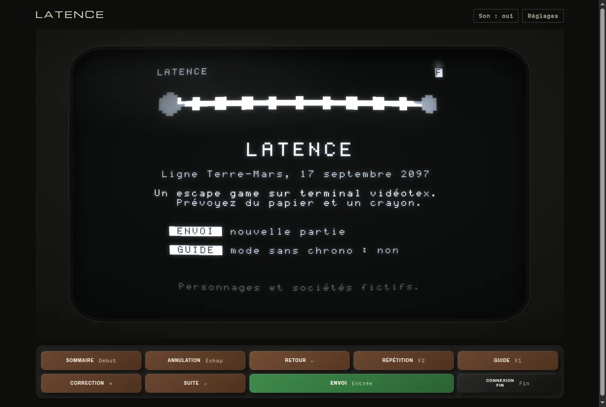
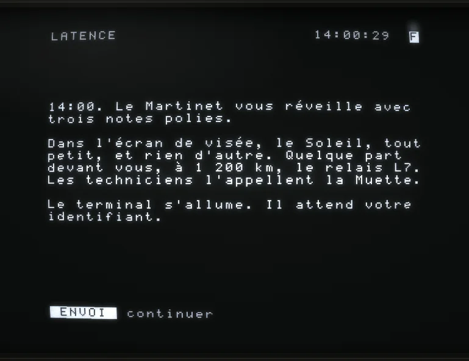
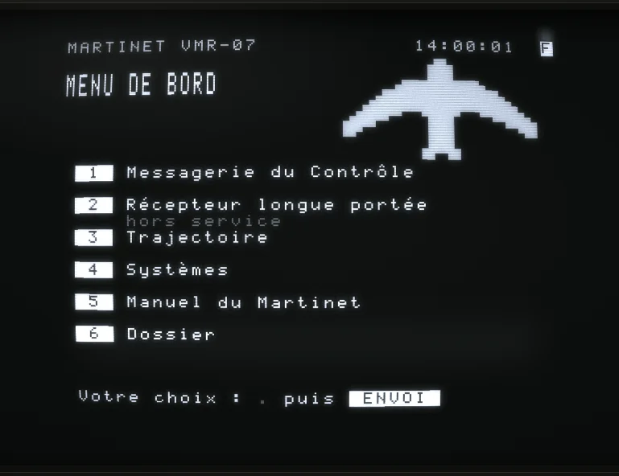

<h1 align="center">LATENCE</h1>

<p align="center">
  <em>Un escape game d'environ 1 h 30, joué entièrement sur un terminal vidéotex recréé pixel par pixel dans le navigateur.</em>
</p>

<p align="center">
  
</p>

> **Mardi 17 septembre 2097.** Le relais L7, au milieu de la Ligne qui relie la Terre à Mars, ne répond plus depuis 19 jours. Vous êtes Alix Vernier, technicien ou technicienne de ligne de la Compagnie Baudot, la seule personne à bord du petit vaisseau de maintenance *Martinet*. Vous avez jusqu'à 15:45 pour réparer le relais et repartir : après, la fenêtre de retour se ferme.
>
> Le Contrôle vous guide pas à pas. Mais ses réponses arrivent trop vite.

<table>
  <tr>
    <td width="50%"></td>
    <td width="50%"></td>
  </tr>
  <tr>
    <td align="center"><sub>14:00, le réveil. L'horloge tourne.</sub></td>
    <td align="center"><sub>Le serveur de bord du <em>Martinet</em>.</sub></td>
  </tr>
</table>

## Le jeu

- **Tout se passe sur l'écran.** Pas d'inventaire, pas de carte, pas de souris à promener sur un décor : un terminal, ses touches de fonction, et les pages qui arrivent à 1200 bauds.
- **Le temps est réel.** La partie démarre à 14:00:00 et la fenêtre se ferme à 15:45:00. Les messages mettent le temps que met la lumière, pour vous aussi.
- **Des énigmes logiques, à une seule solution.** Tout ce qu'il faut savoir est quelque part sur l'écran. Rien n'est caché dans le code de la page.
- **Prévoyez du papier et un crayon.** Vous en aurez besoin.
- **Trois indices par objectif**, du plus vague au plus précis, contre trois minutes chacun. Un mode sans chrono existe pour jouer sans pression.
- **Plusieurs fins**, selon ce que vous aurez compris et ce que vous déciderez.
- **Tout au clavier**, ou au doigt sur téléphone. La partie est sauvegardée dans le navigateur.

Personnages et sociétés fictifs.

## Le terminal

Le terminal n'est pas une imitation en CSS : c'est un vrai décodeur vidéotex qui reçoit des octets et les trace dans un tube.

- **Décodeur vidéotex** : jeux G0, G1 et G2, attributs de caractère et de zone, double taille, répétition, rangée de service, CSI.
- **Ligne à 1200 bauds** : les pages s'affichent au rythme d'origine, 120 caractères par seconde.
- **Tube en WebGL** : faisceau et lignes de balayage, halo, courbure, rémanence du phosphore blanc ou vert, réglables dans un volet. Un rendu 2D prend le relais sans WebGL.
- **Dessins en pavés** : les images sont faites des semi-graphiques 2 × 3 du vidéotex, rien d'autre.
- **Son synthétisé** avec Web Audio, sans aucun fichier : clic des touches, bip, sifflement du modem, ambiances.
- **Moteur d'escape game** sans histoire : scènes, champs de saisie, serveurs, horloge à la seconde, agenda d'événements, messagerie à réponses différées, indices, fins, succès, sauvegarde.
- **Pas de framework** : JavaScript en modules ES, Vite, et environ 50 ko gzip pour la page du jeu.

## Démarrer

```bash
npm install
npm run dev
```

Puis ouvrir <http://localhost:5173>.

| Commande | Rôle |
|---|---|
| `npm run dev` | Serveur de développement |
| `npm test` | Tests du décodeur vidéotex, du moteur de jeu et des énigmes (Vitest) |
| `npm run build` | Build de production dans `dist/` : le jeu, les mentions légales et la page 404, prêts pour la racine de <https://latence-game.com> |
| `npm run preview` | Sert le build en local |
| `npm run mosaique -- image.png --colonnes 12 --rangees 5` | Convertit une silhouette noir et blanc (PNG) en dessin en pavés |
| `npm run images` | Prépare les images du site à partir de `sources/images/` (demande ffmpeg) |

Les pages :
- `index.html` : le jeu.
- `mentions-legales.html` : mentions légales, données personnelles et déclaration d'accessibilité.
- `404.html` : la page introuvable.
- `banc.html` : le banc d'essai, en développement seulement (il n'est pas dans le build), pour poser l'écran sur une photo de terminal (calage des 4 coins par homographie), régler le tube et lire des fichiers `.vdt`.

Options d'URL pour le développement : `?instantane` affiche les pages sans attendre la ligne, `?debug` expose le jeu dans la console (`window.jeu`, en développement seulement), `?essai` ajoute le rapport de partie pour les séances avec des joueurs.

## Mise en ligne

Le site est servi par Apache chez o2switch. Déposer le **contenu** de `dist/` à la racine du domaine, fichiers cachés compris (`.htaccess`, `.well-known/`).

`public/.htaccess` force `https://latence-game.com` sans www, pose les en-têtes de sécurité (CSP stricte : tout vient du site), règle le cache (les fichiers de `assets/` sont immuables) et refuse les robots d'IA et les aspirateurs, que `public/robots.txt` écarte aussi. Les moteurs de recherche et les aperçus de liens restent admis. Pour ajouter un robot, le nommer aux deux endroits.

## Documentation

> ⚠️ Le dossier `docs/latence/` raconte toute l'histoire, solutions comprises. À ne pas ouvrir avant d'avoir joué.

- `docs/moteur.md` : écrire un scénario, l'API des scènes, les règles de conception des énigmes.
- `docs/videotex.md` : mémo du protocole.
- `docs/latence/` : le dossier de conception du jeu (**spoilers**).
- `CLAUDE.md` : consignes, architecture et conventions du code.

## Sources

- STUM 1B, les spécifications techniques d'utilisation, version web : <https://jbellue.github.io/stum1b/>
- Code Baudot (ITA2) : <https://en.wikipedia.org/wiki/Baudot_code>
- Polices : Michroma, Archivo et Martian Mono (licence SIL OFL), via Fontsource.
